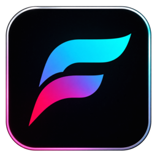
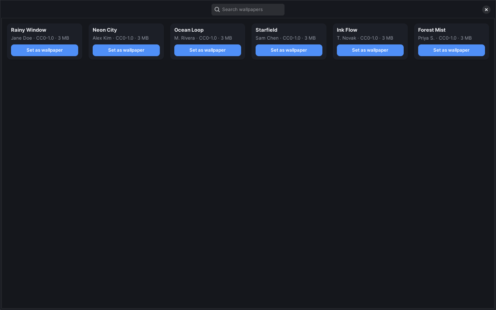

<div align="center">



# Fresco — Application gratuite de fond d’écran animé et vidéo pour Linux

[English](README.md) | [العربية](README.ar.md) | [বাংলা](README.bn.md) | [Deutsch](README.de.md) | [Español](README.es.md) | **Français** | [हिन्दी](README.hi.md) | [Bahasa Indonesia](README.id.md) | [Português (Brasil)](README.pt-BR.md) | [Română](README.ro.md) | [Русский](README.ru.md) | [Türkçe](README.tr.md) | [Tiếng Việt](README.vi.md) | [简体中文](README.zh-CN.md)

**Fresco est une application gratuite et open source de fond d’écran animé pour Linux. Elle utilise n’importe quelle vidéo, GIF ou image comme fond d’écran vidéo ou animé de votre bureau, sous X11 comme sous Wayland.** C’est une alternative native à Wallpaper Engine pour Linux, avec une application graphique, une lecture accélérée par le GPU et des widgets de bureau.

[](https://github.com/DibbayajyotiRoy/fresco/releases/latest)
[](LICENSE)
[](https://github.com/DibbayajyotiRoy/fresco/actions/workflows/publish.yml)
[](https://github.com/DibbayajyotiRoy/fresco/stargazers)

[Site web](https://fresco.dibbayajyoti.com) · [Installation](#installation) · [Environnements pris en charge](#environnements-pris-en-charge) · [Comparatif](#fresco-face-à-wallpaper-engine-hidamari-komorebi-et-mpvpaper) · [FAQ](#questions-fréquentes-faq) · [Widgets](#widgets-de-bureau-paroles-horloges-visualiseur-et-pochette-dalbum) · [Journal des modifications](CHANGELOG.md) · [Issues](https://github.com/DibbayajyotiRoy/fresco/issues)



</div>

## Qu’est-ce que Fresco ?

Fresco transforme une vidéo, un GIF, une image, un diaporama ou une playlist en fond d’écran derrière vos fenêtres, grâce à une application GTK4 / libadwaita qui ne demande aucun terminal. La lecture passe par mpv : le décodage se fait sur le GPU et l’utilisation du CPU reste proche de zéro (voir [Performances et autonomie](#performances-et-autonomie) pour ce que cela coûte réellement sur la prise). Votre fond d’écran est restauré à chaque ouverture de session.

- **Formats lus :** les vidéos (mp4, webm, mkv, avi, mov), les GIF animés, les images, les diaporamas d’images et les playlists de vidéos.
- **Bureaux :** sessions X11 (GNOME sous Xorg, Cinnamon, Xfce, MATE, Deepin 25) et Wayland (COSMIC, Hyprland, Sway, KDE Plasma 6, Cinnamon 6.8+). GNOME sous Wayland n’affiche qu’une image fixe – voir [Environnements pris en charge](#environnements-pris-en-charge).
- **Décodage matériel :** VA-API (Intel, AMD) et NVDEC (NVIDIA), via mpv.
- **Bibliothèque :** liez un dossier de fonds d’écran que vous avez déjà au lieu de l’importer, et gardez-le synchronisé à mesure que les fichiers vont et viennent. La bibliothèque ne dessine que ce qui est à l’écran, si bien que des milliers de fonds d’écran restent rapides et légers.
- **Widgets :** paroles synchronisées avec la musique, horloges (dont une horloge mondiale), un visualiseur audio et la pochette d’album, dessinés directement dans le fond d’écran. Tous désactivés par défaut.
- **Contrôle :** l’application, une palette de commandes (Ctrl+K) et `fresco next` / `fresco prev` / `fresco random` pour les raccourcis clavier.
- **Installation :** un `.deb` pour Ubuntu, Debian, Linux Mint, Pop!_OS, elementary OS, Kali et Deepin (script en une ligne, téléchargement manuel ou App Store de Deepin) ; compilation depuis les sources sous Fedora, Arch et les autres – voir [Installation](#installation).
- **Licence :** libre et open source sous [GPL-3.0-or-later](LICENSE), sans publicité et sans compte.
- **Utilisateurs :** plus de 3 000 personnes dans 128 pays. Dernière version : 1.1.51.

## Installation

Fresco est fourni sous forme de `.deb` pour les distributions de la famille Debian, et se compile depuis les sources partout ailleurs.

### Ubuntu, Debian, Linux Mint, Pop!_OS, elementary OS et Kali Linux

Installation en une ligne : elle télécharge le dernier `.deb` depuis GitHub Releases et l’installe avec apt :

```bash
curl -fsSL https://github.com/DibbayajyotiRoy/fresco/releases/latest/download/install.sh | FRESCO_SOURCE=github bash
```

Ou téléchargez le `.deb` depuis les [Releases](https://github.com/DibbayajyotiRoy/fresco/releases/latest) et exécutez :

```bash
sudo apt install ./fresco_*.deb
```

### Deepin 25

Ouvrez **App Store**, recherchez **Fresco** et cliquez sur **Installer**. Fresco est publié sur l’App Store communautaire de deepin : il n’y a donc rien à télécharger à la main, et les mises à jour arrivent par la boutique. L’installation en une ligne ci-dessus fonctionne aussi sous Deepin.

### Fedora, Arch Linux et autres distributions

Il n’existe pas encore de paquet précompilé pour ces distributions : il faut donc compiler depuis les sources. Il vous faut Rust (via [rustup](https://rustup.rs)) ainsi que les fichiers de développement de GTK4, libadwaita et libmpv :

```bash
git clone https://github.com/DibbayajyotiRoy/fresco.git && cd fresco
cargo build --release --all-features
```

Sur les compositeurs Wayland, Fresco a aussi besoin du moteur de rendu `mpvpaper`, que le `.deb` embarque et qu’une compilation depuis les sources n’inclut pas :

```bash
# Arch Linux, CachyOS, EndeavourOS (AUR)
yay -S mpvpaper

# Fedora et toutes les autres : compilez-le avec la libmpv de votre système
scripts/build-mpvpaper.sh
install -Dm755 target/release/mpvpaper ~/.local/bin/mpvpaper   # doit être dans le PATH
```

Fresco n’est ni sur l’AUR ni sur Flathub : le paquet AUR nommé `fresco` est un programme de physique sans rapport. Les détails et le dépannage se trouvent dans [docs/INSTALL.md](docs/INSTALL.md).

Une fois l’installation terminée, ouvrez **Fresco** depuis votre lanceur d’applications. Si quelque chose ne va pas, lancez `fresco doctor`.

## Comment définir une vidéo comme fond d’écran sous Linux

Installez Fresco, cliquez sur **Ajouter**, choisissez votre vidéo, puis cliquez sur **Définir comme fond d’écran**. La vidéo se lit derrière vos fenêtres et revient automatiquement à chaque ouverture de session.

1. Installez Fresco (voir ci-dessus) et ouvrez-le depuis votre lanceur d’applications.
2. Cliquez sur **Ajouter** et choisissez une vidéo, un GIF ou une image – ou collez un lien avec **Depuis un lien**.
3. Si vous le souhaitez, recadrez-la ou faites-la pivoter dans l’éditeur.
4. Cliquez sur **Définir comme fond d’écran**, puis fermez l’application.

Le fond d’écran continue de se lire après la fermeture de la fenêtre.

## Fonctionnalités

- **Tous les médias** – vidéo en boucle (mp4/webm/mkv), GIF animé, image fixe, diaporama d’images, playlist de plusieurs vidéos
- **Ajout depuis un lien** – collez une épingle Pinterest ou n’importe quelle URL directe de vidéo ou d’image ; Fresco la télécharge et ouvre l’éditeur de recadrage
- **Lier un dossier** – utilisez un dossier de fonds d’écran que vous avez déjà (images, GIF et vidéos) sans l’importer ; il reste synchronisé quand vous ajoutez et retirez des fichiers, les sous-dossiers sont facultatifs, et vos favoris et modifications sont conservés fichier par fichier
- **Grandes bibliothèques** – la bibliothèque ne dessine que les fonds d’écran proches de votre position de défilement, si bien que des milliers de fonds d’écran s’ouvrent en environ deux secondes et occupent quelques centaines de mégaoctets (sur une bibliothèque de test de 4 000 fonds d’écran : environ 2 s et 325 Mo, contre 9 à 13 s et 1,6 Go)
- **Décodage matériel** – le décodage vidéo sur le GPU (VA-API / NVDEC) maintient l’utilisation du CPU proche de zéro en confiant le travail au moteur vidéo, où il est mesurablement moins coûteux (pas gratuit pour autant – voir [Performances et autonomie](#performances-et-autonomie))
- **Économie d’énergie** – une mise à l’échelle GPU moins gourmande pour les portables ; mesurée, elle divise environ par deux la puissance du GPU (voir [Performances et autonomie](#performances-et-autonomie))
- **Plusieurs écrans** – un fond d’écran différent par écran, avec une lecture synchronisée quand la même vidéo tourne sur plusieurs moniteurs
- **Horaires jour et nuit** – changez de fond d’écran selon une minuterie, des plages horaires de votre choix, ou le lever et le coucher du soleil
- **Widgets de bureau** – paroles synchronisées, horloges à thèmes, horloge mondiale, visualiseur audio et disque de pochette d’album qui tourne, dessinés dans le fond d’écran lui-même pour que rien ne recouvre vos fenêtres (l’horloge mondiale propose un mode optionnel flottant au-dessus des fenêtres) ; tous désactivés par défaut (voir [Widgets de bureau](#widgets-de-bureau-paroles-horloges-visualiseur-et-pochette-dalbum))
- **Écran de verrouillage** – affichez votre fond d’écran et vos widgets (horloge, message d’accueil, lecture en cours, batterie, etc.) sur votre véritable écran de verrouillage plutôt que sur celui par défaut : vidéo animée et widgets sous COSMIC 1.9+ et KDE Plasma 6, fond d’écran et widgets via `fresco lock` sous Sway/Hyprland/niri et X11, image fixe ailleurs. Désactivé par défaut, et Fresco ne voit jamais votre mot de passe – voir [docs/LOCKSCREEN.md](docs/LOCKSCREEN.md)
- **Contrôle au clavier** – `fresco next`, `fresco prev` et `fresco random` pour les raccourcis du compositeur (une fenêtre Fresco ouverte prend en compte le changement au lieu de l’annuler), et une palette de commandes (Ctrl+K) dans l’application
- **Gestion par lots** – sélectionnez plusieurs fonds d’écran à la fois et retirez-les en une seule étape
- **Catalogue intégré** – parcourez dans l’application des fonds d’écran sélectionnés et correctement sous licence
- **Pause automatique en plein écran** – par moniteur, sous X11, les compositeurs wlroots, COSMIC et KDE Plasma (via son module de fond d’écran) ; en option aussi pour les fenêtres maximisées, avec en plus la pause sur batterie
- **Extension pour les nouveaux onglets du navigateur** – reprend votre fond d’écran dans chaque nouvel onglet (Chrome/Brave/Edge/Firefox ; à charger en mode non empaqueté depuis [`./extension`](extension))
- **Prise en charge de Deepin DDE** – sous Deepin 25, Fresco adapte automatiquement le bureau DDE, et un clic sur le bureau fait revenir les icônes pendant dix secondes dès que vous en avez besoin (voir [Dépannage](#mes-icônes-du-bureau-sont-masquées-pendant-la-lecture-du-fond-décran-sous-deepin))
- **Éditeur de recadrage et de rotation**, son et volume par fond d’écran, transitions de diaporama et bibliothèque avec recherche

## Environnements pris en charge

| Environnement | Fond d’écran animé | Remarques |
|---|---|---|
| X11 (GNOME, Cinnamon, XFCE, …) | ✅ | Moteur de rendu intégré. GNOME uniquement là où la distribution fournit encore une session Xorg (voir la note sur GNOME ci-dessous) |
| Kali Linux (Xfce, X11) | ✅ | Fonctionne sur la session par défaut de Kali, Xfce sous X11, avec le même moteur de rendu intégré que les autres bureaux X11 |
| Xfce (X11) | ✅ | Les icônes du bureau restent visibles au-dessus du fond d’écran, et vous pouvez les cliquer, les sélectionner et les faire glisser |
| MATE (X11) | ✅ | Les icônes du bureau restent visibles et cliquables au-dessus du fond d’écran |
| Deepin 25 (DDE, X11) | ✅ | Adaptation automatique à DDE – vérifiée par la communauté sur Deepin 25 Community build1 |
| COSMIC (Wayland) | ✅ | layer-shell |
| Hyprland | ✅ | layer-shell |
| Sway | ✅ | layer-shell |
| Cinnamon 6.8 et suivants (Wayland) | ✅ | Le compositeur de Cinnamon a gagné layer-shell dans la version 6.8. Cinnamon 6.6 et antérieurs n’ont pas layer-shell et conservent une image fixe sous Wayland |
| KDE Plasma 6 (X11 et Wayland) | ✅ | Appliqué via le propre module de fond d’écran de plasmashell, donc les icônes du bureau restent visibles. Nécessite `qml6-module-qtmultimedia` pour la vidéo. La lecture est assurée par Qt, pas par mpv : sans son, sans réglage hwdec, recadrage ni transitions ; une playlist lit son premier fichier et un diaporama affiche sa première image. L’option Ajustement (Couvrir, Ajuster, Étirer) est respectée |
| GNOME sous Wayland | ⚠️ | Image fixe uniquement – Mutter n’expose aucune surface de fond d’écran animé, donc ni vidéo ni widgets. La vidéo animée nécessitera une extension GNOME pour Fresco (prévue) |

Chacun des environnements ci-dessus est testé en mode headless dans la CI à chaque version.

**Note sur GNOME.** GNOME sous Wayland est le seul grand bureau grand public sur lequel Fresco ne peut afficher qu’une image fixe. L’ancien contournement, ouvrir une session Xorg, est en train de disparaître : GNOME 49 a désactivé sa session X11 et GNOME 50 l’a supprimée, si bien qu’Ubuntu 25.10 et suivantes (dont la 26.04 LTS) ainsi que Fedora 43 et suivantes ne fournissent aucune session Xorg vers laquelle basculer. Ubuntu 22.04 et 24.04 proposent toujours « Ubuntu on Xorg ». Là où il n’y a pas de session Xorg, la vidéo animée sur le bureau GNOME standard devra attendre une extension GNOME pour Fresco, qui est prévue ; Fresco l’indique dans l’application au lieu de faire semblant de lire la vidéo. KDE Plasma, COSMIC, Hyprland, Sway et tous les bureaux X11 ne sont pas concernés.

> « Facile à utiliser, avec une interface claire – l’une des rares applications de fond d’écran animé réellement adaptées à Deepin 25, installable via .deb et fluide grâce à la lecture accélérée par le matériel. »
>
> — 柒玖 (forum deepin) / 柒仈玖 (GitHub), testé sur Deepin 25 Community build1, session X11, Intel Alder Lake-N [Intel Graphics]

Deepin 25 est livré avec X11 comme session par défaut, et c’est la session sur laquelle Fresco y est vérifié. Le compositeur Wayland propre à Deepin, [Treeland](https://github.com/linuxdeepin/treeland), est encore en développement : Fresco ne revendique donc rien pour Deepin sous Wayland pour le moment.

## Fresco face à Wallpaper Engine, Hidamari, Komorebi et mpvpaper

| Outil | Plateforme | Wayland | X11 | Interface | Lit | Licence |
|---|---|---|---|---|---|---|
| **Fresco** | Linux | ✅ compositeurs layer-shell et KDE Plasma 6 ; image fixe sous GNOME | ✅ | Application GTK4, plus une CLI `fresco` | Vidéo, GIF, images, diaporamas, playlists | GPL-3.0-or-later |
| **Wallpaper Engine** | Windows (Steam) ; pas de version Linux officielle | n/a | n/a | Application graphique | Fonds d’écran vidéo, scènes et web | Payant, code fermé |
| **[linux-wallpaperengine](https://github.com/Almamu/linux-wallpaperengine)** | Linux ; nécessite les ressources d’une copie Steam de Wallpaper Engine | ✅ compositeurs avec layer-shell | ⚠️ pas quand un environnement de bureau (GNOME, KDE) dessine l’arrière-plan | Ligne de commande ; son README liste des interfaces graphiques communautaires distinctes | Fonds d’écran Wallpaper Engine | GPL-3.0 |
| **[Hidamari](https://github.com/jeffshee/hidamari)** | Linux, centré sur GNOME | ⚠️ GNOME Wayland | ✅ | Application graphique | Vidéo | GPL-3.0 |
| **[Komorebi](https://github.com/cheesecakeufo/komorebi)** | Linux | — | — | Application graphique | Fonds d’écran image, vidéo et page web | GPL-3.0 |
| **[mpvpaper](https://github.com/GhostNaN/mpvpaper)** | Linux, compositeurs basés sur wlroots | ✅ layer-shell | ❌ | Ligne de commande | Vidéo, via mpv | GPL-3.0 |
| **xwinwrap** | Linux, X11 uniquement | ❌ | ✅ | Ligne de commande | Le lecteur que vous y attachez (mpv, gifview) | — |
| **swww** (désormais [awww](https://codeberg.org/LGFae/awww)) | Linux, compositeurs layer-shell ; pas GNOME | ✅ | ❌ | Démon en ligne de commande | GIF animés et images, pas de vidéo | GPL-3.0 |

Fresco embarque `mpvpaper` comme moteur de rendu Wayland : il s’appuie donc sur ce projet plutôt que de lui faire concurrence. Un `—` signifie que la documentation du projet ne le précise pas clairement. Vérifié le 2026-10-16 d’après le dépôt public de chaque projet : le dernier push sur le dépôt de Komorebi date de juillet 2025, et le dépôt GitHub de swww est archivé parce que le projet a déménagé sur Codeberg sous le nom awww.

## Performances et autonomie

柒玖 (forum deepin) / 柒仈玖 (GitHub) a mesuré la puissance du package avec `turbostat` sur un Intel N150 (Deepin 25, VA-API, deux mesures par niveau) pendant la lecture d’un fond d’écran vidéo :

| Vidéo | Économie d’énergie | Puissance du GPU | Puissance totale du package |
|---|---|---|---|
| 1080p 60fps | Qualité maximale | 1,37 W | 6,00 W |
| 1080p 60fps | **Réduite** (par défaut) | **0,63 W** (−54 %) | **4,03 W** (−33 %) |
| 4K 60fps | Qualité maximale | 2,77 W | 7,94 W |
| 4K 60fps | **Réduite** (par défaut) | **1,60 W** (−42 %) | **5,95 W** (−25 %) |
| 4K 60fps | Minimale | 0,99 W (−65 %) | 4,97 W (−37 %) |

L’économie d’énergie réduit le coût de mise à l’échelle du GPU à chaque image. Aucune image n’est abandonnée et le décodage matériel n’est pas touché : la lecture reste fluide, et le compromis porte sur la netteté de l’image, pas sur le mouvement. Réduite est le réglage par défaut ; Minimale vaut le coup pour les sources 4K.

**Comment lire ces chiffres.** Le décodage matériel ne rend pas un fond d’écran animé gratuit : il déplace le travail du CPU vers le moteur vidéo, où il coûte moins cher, mais ne disparaît pas. « Faible utilisation du CPU » ne dit pas grand-chose à lui seul, car l’alternative à laquelle on se compare est le décodage logiciel, bien pire ; la mesure honnête est la consommation de l’ensemble du système, et c’est pourquoi le tableau indique la **puissance totale du package** et pas seulement celle du GPU.

Deux réserves sur ces chiffres, pour qu’on ne leur fasse pas dire plus qu’ils ne disent :

- Il s’agit de la **puissance totale du package pendant la lecture d’un fond d’écran**, pas du coût marginal du fond d’écran. Aucune mesure au repos n’a été faite sur la même machine : l’écart entre ces chiffres et un bureau inactif n’est donc pas établi ici. Les pourcentages comparent entre eux les *niveaux* d’économie d’énergie, et c’est pour cela qu’ils sont valables.
- Il s’agit d’une seule machine (Intel N150, Alder Lake-N, VA-API, Deepin 25, deux mesures par niveau). Les GPU dédiés, NVDEC et d’autres pilotes donneront des résultats différents.

Un fond d’écran animé coûte toujours plus cher qu’un fond d’écran statique. L’économie d’énergie, la pause automatique en plein écran et la pause sur batterie servent à borner ce coût, pas à prétendre qu’il est nul.

## Questions fréquentes (FAQ)

### Existe-t-il une alternative à Wallpaper Engine pour Linux ?

Oui. Fresco est une application Linux gratuite et open source qui lit vos propres fonds d’écran vidéo, GIF et image via une interface graphique, avec décodage matériel et sans couche de compatibilité. Elle n’ouvre pas les fichiers de fonds d’écran propres à Wallpaper Engine ; si vous possédez Wallpaper Engine et voulez ces fonds d’écran sous Linux, le projet distinct [linux-wallpaperengine](https://github.com/Almamu/linux-wallpaperengine) les exécute en ligne de commande et nécessite les ressources d’une copie Steam de Wallpaper Engine. Voir le [tableau comparatif](#fresco-face-à-wallpaper-engine-hidamari-komorebi-et-mpvpaper).

### Wallpaper Engine fonctionne-t-il sous Linux ?

Pas nativement. Wallpaper Engine est une application Windows sans version Linux officielle. Fresco est une alternative native pour Linux qui s’installe sous forme de `.deb` et n’a besoin d’aucune couche de compatibilité.

### Comment définir une vidéo comme fond d’écran animé sous Ubuntu ?

Installez Fresco, ouvrez-le, cliquez sur **Ajouter**, choisissez votre vidéo, puis cliquez sur **Définir comme fond d’écran**. La vidéo se lit comme arrière-plan du bureau et est restaurée à l’ouverture de session. La session par défaut d’Ubuntu (GNOME sous Wayland) ne peut afficher qu’une image fixe. Sous Ubuntu 22.04 et 24.04, vous pouvez ouvrir une session **Ubuntu on Xorg** pour une lecture animée complète ; Ubuntu 25.10 et suivantes (dont la 26.04 LTS) ne fournissent pas de session Xorg : la vidéo animée sur le bureau GNOME standard y nécessite donc une extension GNOME pour Fresco, qui est prévue. Les variantes d’Ubuntu qui utilisent KDE Plasma, Xfce ou MATE ne sont pas concernées.

### Comment obtenir un fond d’écran animé sous Ubuntu, Linux Mint, Pop!_OS, Fedora ou Arch Linux ?

Installez le `.deb` de Fresco sous Ubuntu, Linux Mint et Pop!_OS, ou compilez-le depuis les sources sous Fedora et Arch Linux. Les commandes pour chacune se trouvent dans [Installation](#installation).

- **Ubuntu :** `.deb`. Sur le bureau GNOME par défaut, la lecture animée nécessite une session Xorg (Ubuntu 22.04 et 24.04) ; les variantes KDE Plasma, Xfce et MATE ne sont pas concernées – voir la réponse Ubuntu ci-dessus.
- **Linux Mint :** `.deb`. Cinnamon sous X11 est pris en charge, et Cinnamon sous Wayland à partir de la version 6.8.
- **Pop!_OS :** `.deb`. Le bureau COSMIC (Wayland, layer-shell) est pris en charge.
- **Fedora :** compilation depuis les sources. GNOME de Fedora 43 et suivantes ne fonctionne que sous Wayland et affiche donc une image fixe ; KDE Plasma et les bureaux X11 sont pris en charge.
- **Arch Linux :** compilation depuis les sources et installation de `mpvpaper` depuis l’AUR (`yay -S mpvpaper`).

Seule la voie du `.deb` est couverte par la CI de Fresco.

### Quelles distributions Linux sont prises en charge ?

Fresco fournit un paquet `.deb` pour les distributions basées sur Debian et Ubuntu : Ubuntu, Pop!_OS, Linux Mint, Debian, elementary OS, Deepin 25 et Kali Linux. Les autres distributions peuvent le compiler depuis les sources – voir [Installation](#installation) et [docs/INSTALL.md](docs/INSTALL.md).

### Les fonds d’écran animés consomment-ils beaucoup de CPU, de GPU ou de batterie ?

CPU, non. Batterie, un peu – un fond d’écran animé n’est jamais gratuit.

Fresco décode la vidéo sur le GPU (VA-API / NVDEC), de sorte que l’utilisation du CPU reste proche de zéro. Cela déplace le coût vers le moteur vidéo au lieu de le supprimer. Mesuré sur un Intel N150 au niveau d’économie d’énergie par défaut, un fond d’écran 1080p a consommé 0,63 W de puissance GPU, pour une puissance totale du package de 4,03 W pendant la lecture (voir [Performances et autonomie](#performances-et-autonomie) pour savoir comment lire ce chiffre, y compris ce qu’il ne dit *pas*). La pause automatique en plein écran et la pause sur batterie servent à éviter que ce coût pèse sur votre batterie quand c’est le plus gênant.

### Fresco fonctionne-t-il sous Wayland ?

Oui, sur les compositeurs qui implémentent le protocole layer-shell – COSMIC, Hyprland et Sway – ainsi que sous KDE Plasma 6 (X11 et Wayland) via le propre module de fond d’écran de plasmashell. GNOME sous Wayland fait exception : Mutter n’expose aucune surface de fond d’écran, donc Fresco y affiche une image fixe et le dit dans l’application. Les sessions X11 sont entièrement prises en charge.

### Fresco fonctionne-t-il sous GNOME ?

Oui sous X11, avec le fond d’écran animé complet – vidéo, widgets, tout. Sous **GNOME avec Wayland**, Mutter n’expose aucune surface de fond d’écran dans laquelle une application pourrait dessiner : Fresco y affiche donc une image fixe, et les widgets ne sont pas disponibles. Si votre distribution fournit encore une session Xorg (c’est le cas d’Ubuntu 22.04 et 24.04), déconnectez-vous et choisissez « GNOME on Xorg » ou « Ubuntu on Xorg » pour une lecture animée complète. GNOME 49 a désactivé cette session et GNOME 50 l’a supprimée : Ubuntu 25.10 et suivantes (dont la 26.04 LTS) ainsi que Fedora 43 et suivantes n’en ont donc pas, et la vidéo animée sous GNOME y nécessite une extension GNOME pour Fresco, qui est prévue. `fresco doctor` vous indique dans quel cas vous vous trouvez.

### Fresco fonctionne-t-il sous KDE Plasma, COSMIC, Hyprland ou Sway ?

Oui, sur les quatre. COSMIC, Hyprland et Sway lisent la vidéo animée via layer-shell. KDE Plasma 6 (X11 et Wayland) utilise le propre module de fond d’écran de Fresco à l’intérieur de plasmashell, qui laisse les icônes du bureau visibles mais lit via Qt au lieu de mpv : sans son, sans recadrage ni transitions, et il faut `qml6-module-qtmultimedia` pour la vidéo. L’option Ajustement (Couvrir, Ajuster ou Étirer) s’y applique aussi.

### Fresco fonctionne-t-il sous Linux Mint, Xfce, Cinnamon ou MATE ?

Oui. Cinnamon, Xfce et MATE sous X11 utilisent le moteur de rendu intégré, et les icônes du bureau restent visibles au-dessus du fond d’écran sous Xfce et MATE ; sous Xfce, vous pouvez les cliquer, les sélectionner et les faire glisser comme d’habitude. Cinnamon sous Wayland fonctionne à partir de Cinnamon 6.8, qui a ajouté layer-shell.

### Comment changer de fond d’écran avec un raccourci clavier ?

Associez `fresco next`, `fresco prev` ou `fresco random` à une touche dans votre compositeur ou dans les paramètres de votre bureau : ils changent le fond d’écran sans ouvrir l’application (`random` ne choisit jamais celui qui est déjà en cours de lecture). Ils parcourent votre bibliothèque dans l’ordre où l’application l’affiche, ou seulement le dossier que vous y avez ouvert, et démarrent le service Fresco s’il n’est pas lancé. Si la fenêtre Fresco est ouverte à ce moment-là, elle prend en compte le nouveau fond d’écran au lieu de remettre l’ancien. Dans l’application, Ctrl+K ouvre une palette de commandes. Par exemple sous Sway :

```
bindsym $mod+Right  exec fresco next
bindsym $mod+Left   exec fresco prev
bindsym $mod+Return exec fresco random
```

### Puis-je utiliser un fond d’écran différent sur chaque écran ?

Oui. Fresco prend en charge un fond d’écran par écran, et quand la même vidéo est utilisée sur plusieurs moniteurs, la lecture reste synchronisée.

### Les GIF et les diaporamas d’images sont-ils pris en charge ?

Oui : GIF animés, images fixes, diaporamas d’images avec transitions (fondu au noir, Ken Burns, zoom et flou) et playlists de plusieurs vidéos, en plus des fichiers vidéo.

### Fresco peut-il utiliser mon dossier de fonds d’écran existant sans l’importer ?

Oui. Choisissez **Lier un dossier…** dans le menu (ou **Lier ce dossier** après **Ajouter un dossier**) pour indiquer à Fresco un dossier où vous gardez déjà vos fonds d’écran. Ses images, GIF et vidéos apparaissent dans votre bibliothèque, dans une section à part, là où ils se trouvent, sans être importés, et la bibliothèque reste synchronisée quand vous ajoutez et retirez des fichiers dans ce dossier. **Inclure les sous-dossiers** est facultatif (jusqu’à quatre niveaux de profondeur), et vos favoris et modifications sont mémorisés fichier par fichier. Si le dossier disparaît, par exemple parce qu’un disque est débranché, sa section reste marquée « (indisponible) » et revient d’elle-même. **Délier le dossier**, dans le menu de la section, retire la section sans supprimer aucun fichier. **Ajouter** importe toujours les fichiers individuels comme avant.

### Fresco peut-il gérer des milliers de fonds d’écran ?

Oui. La bibliothèque ne construit que les cartes des fonds d’écran proches de l’endroit où vous faites défiler, au lieu de tous en même temps, si bien qu’une grande collection n’alourdit pas l’application. Sur une bibliothèque de test de 4 000 fonds d’écran (moitié images, moitié vidéos), la bibliothèque est apparue en environ 2 secondes au lieu de 9 à 13, et l’application a utilisé environ 325 Mo de mémoire au lieu de 1,6 Go. Ces chiffres proviennent d’une version de développement sous charge sur une seule machine ; prenez-les comme une indication plutôt que comme une promesse.

### Puis-je utiliser une vidéo YouTube comme fond d’écran vidéo ?

Pas en collant son lien. **Depuis un lien** accepte les épingles Pinterest et les liens directs vers un fichier vidéo ou image (mp4, webm, mkv, mov, gif, jpg, png, webp) ; les autres liens sont refusés avec un message. Ajoutez avec **Ajouter** un fichier vidéo que vous avez déjà, ou collez un lien direct vers un fichier.

### Fresco est-il gratuit et open source ?

Oui. Fresco est gratuit et open source sous GPL-3.0-or-later. Il n’y a ni publicité, ni compte, ni offre payante.

### Fresco collecte-t-il mes données ?

Rien n’est envoyé tant que vous n’avez pas répondu à une boîte de dialogue de consentement qui n’apparaît qu’une fois. Vous choisissez entre un décompte quotidien anonyme (identifiant d’installation aléatoire, pays, version de l’application) et ce même décompte accompagné de détails facultatifs ; avec `telemetry = false` dans `~/.config/fresco/config.toml`, rien n’est envoyé du tout. Voir [Confidentialité et conditions d’utilisation](#confidentialité-et-conditions-dutilisation) pour chaque champ.

### Quelle est la différence entre Fresco et mpvpaper ?

`mpvpaper` est une surcouche en ligne de commande de mpv qui lit une seule vidéo comme arrière-plan layer-shell de Wayland – sans interface graphique, sans bibliothèque, sans prise en charge de X11. Fresco est une application de bureau GTK4 construite autour de lui : bibliothèque de fonds d’écran, éditeur de recadrage et de rotation, planification, synchronisation multi-écrans, widgets de bureau et prise en charge de X11, sans aucun terminal. Fresco embarque `mpvpaper` comme moteur de rendu Wayland au lieu de le remplacer – voir le [tableau comparatif](#fresco-face-à-wallpaper-engine-hidamari-komorebi-et-mpvpaper).

### Puis-je utiliser Fresco sur Kali Linux ?

Oui. Kali Linux est basée sur Debian : Fresco s’y installe donc comme sous Debian ou Ubuntu – avec le paquet `.deb` ou le script d’installation en une ligne (voir [Installation](#installation)). Le bureau par défaut de Kali, Xfce sous X11, est pris en charge grâce au moteur de rendu X11 intégré de Fresco.

### Comment retirer plusieurs fonds d’écran à la fois ?

Cliquez sur **Sélectionner** dans la barre du bas (ou faites un clic droit sur un fond d’écran et choisissez **Sélectionner…**), cochez ceux que vous voulez, puis cliquez sur **Retirer**. **Tout sélectionner** respecte la recherche en cours : vous pouvez donc chercher d’abord, puis retirer tout un lot. Retirer un fond d’écran ne le supprime que de votre bibliothèque Fresco – le fichier source est conservé sur le disque.

### Comment désinstaller Fresco ?

Si vous avez installé le `.deb` ou utilisé le script d’installation, exécutez `sudo apt remove fresco`. Votre bibliothèque et votre configuration se trouvent dans `~/.local/share/fresco/` et `~/.config/fresco/` ; supprimez ces répertoires pour ne laisser aucune trace. Pour retrouver le fond d’écran propre à votre bureau sans désinstaller, ouvrez Fresco et cliquez sur **Arrêter le fond d’écran**.

## Widgets de bureau : paroles, horloges, visualiseur et pochette d’album

Fresco dessine cinq widgets facultatifs sur votre fond d’écran. Tous sont **désactivés par défaut** ; activez-les depuis le menu de l’application (Ctrl+,) → **Avancé…**.

| Widget | Ce que vous obtenez |
|---|---|
| **Paroles** | La ligne en cours, en rythme avec la musique. Quatre préréglages (Minimal, Karaoké, Sous-titre, Carte), une grille de placement à neuf positions, un curseur de décalage de synchronisation, une ligne suivante atténuée en option, ainsi que le titre et l’artiste en option |
| **Horloge** | Huit thèmes : Numérique, Minimal, Segments, Empilé, Textuel, Carte, NOS et un cadran façon téléphone, Écran de verrouillage. Format 12 ou 24 heures, date en option, réglages de couleur et d’opacité. Les secondes sont désactivées par défaut car elles coûtent 60 fois plus de redessins |
| **Horloge mondiale** | L’heure dans plusieurs villes à la fois, choisies dans la liste complète des fuseaux horaires, en simple texte 12 heures (par exemple `Tokyo  9:41 PM`) avec un libellé facultatif par ville. Redessinée une fois par minute. Nouveau dans la 1.1.50 |
| **Visualiseur audio** | Cinq styles – Barres, Miroir, Vague, Points, Anneau – avec un sélecteur de couleur, un dégradé entre deux couleurs ou un arc-en-ciel |
| **Pochette d’album** | La pochette du morceau en cours sur un disque qui tourne ; il s’arrête quand la lecture est en pause |

À l’exception du mode facultatif **Flotter au-dessus des fenêtres** de l’horloge mondiale, les widgets sont peints dans le fond d’écran via la couche OSD de mpv plutôt que dans une fenêtre à eux : ils ne passent donc jamais au-dessus de vos fenêtres, n’interceptent jamais un clic et se comportent à l’identique sous X11 et sur tous les compositeurs layer-shell. Avec de la musique en cours et les widgets paroles, horloge, visualiseur et pochette d’album activés, le coût mesuré était de **0,8 % d’un cœur de CPU** – presque tout dû à la capture audio, puisque rien n’est redessiné tant que son contenu n’a pas changé. Les widgets reviennent aussi d’eux-mêmes après une mise en veille et une reprise de la machine.

Les widgets apparaissent par défaut sur **tous les écrans**. Pour les garder sur un seul, ajoutez `monitor = "DP-1"` dans le bloc `[widgets]` de `config.toml` (il n’existe pas encore de réglage dans l’interface graphique). Ils **ne sont pas disponibles sous GNOME avec Wayland**, qui n’a pas de surface de fond d’écran animé dans laquelle Fresco pourrait dessiner – c’est la même raison pour laquelle les fonds d’écran y reviennent à une image fixe.

### Puis-je ajouter une horloge au fond d’écran de mon bureau Linux ?

Oui. Activez le widget **Horloge** pour une horloge à thème dessinée dans le fond d’écran, ou l’**Horloge mondiale** pour afficher plusieurs villes à la fois. L’horloge mondiale se place sur le fond d’écran comme les autres widgets ; son mode facultatif **Flotter au-dessus des fenêtres** la fait passer au-dessus de toutes les applications, les clics la traversant, ce qui fonctionne sous X11 avec un compositeur et sur les compositeurs layer-shell (KDE Plasma, COSMIC, Sway, Hyprland), et retombe sur le fond d’écran là où une session ne peut pas la faire flotter, comme GNOME avec Wayland.

### Puis-je afficher les paroles de chansons sur mon bureau Linux ?

Oui. Fresco dessine des **paroles synchronisées dans le temps** sur votre fond d’écran, en suivant ce qui est lu sur votre système via MPRIS – navigateurs, applications de musique, lecteurs vidéo. Choisissez un préréglage, un placement et un décalage de synchronisation dans les réglages du widget Paroles (voir le tableau ci-dessus).

### Linux a-t-il des widgets de bureau comme Conky ?

Oui, et Fresco en ajoute cinq qui n’exigent ni barre, ni extension, ni aide de votre bureau : une horloge, une horloge mondiale, des paroles synchronisées, un visualiseur audio et un disque de pochette d’album qui tourne. Comme ils sont peints dans le fond d’écran et non dans une fenêtre, ils fonctionnent sur les bureaux qui n’ont pas de couche de widgets propre – COSMIC, Hyprland et Sway compris. Contrairement à Conky, Fresco n’a **aucun widget de supervision du système** (pas d’indicateurs de CPU, de RAM, de température ou de réseau) : il accompagne donc Conky comme compagnon de musique et d’heure au lieu de le remplacer. GNOME avec Wayland est le seul endroit où il ne peut pas fonctionner.

### Puis-je avoir un visualiseur de musique sur l’arrière-plan de mon bureau ?

Oui. Le visualiseur audio de Fresco réagit à tout ce que lit votre système, dans l’un de cinq styles – Barres, Miroir, Vague, Points ou Anneau – avec un sélecteur de couleur, un dégradé entre deux couleurs ou un arc-en-ciel. Il est désactivé par défaut et demande votre consentement la première fois que vous l’activez, car il doit écouter votre sortie audio ; le consentement est aussi vérifié au chargement de la configuration, si bien que modifier `config.toml` à la main ne peut pas l’activer dans votre dos. Associez-le au widget de pochette d’album pour obtenir un disque qui tourne avec la pochette du morceau en cours.

### Quels lecteurs de musique fonctionnent avec le widget de paroles ?

Tout ce qui publie des métadonnées MPRIS standard, mais ils ne sont pas tous aussi fiables :

| Lecteur | Fonctionne ? | Remarques |
|---|---|---|
| **Firefox** | ✅ | Le choix fiable, et celui avec lequel la fonctionnalité a été vérifiée |
| Chrome / Brave / Edge / Vivaldi / Opera | ⚠️ | Voir ci-dessous |
| Spotify – **dans un navigateur** | ✅ | Indique correctement la position de lecture |
| Spotify – **client Linux natif** | ⚠️ | Indique sa position à 0 en permanence : les paroles ne peuvent donc pas rester synchronisées |
| Lecteurs locaux (VLC, mpv, Rhythmbox, …) | ✅ | C’est aussi le cas où un fichier `.lrc` local a le plus de chances d’exister |

Les navigateurs de la famille Chromium réservent un nom MPRIS la première fois
qu’un onglet lit un média et **ne le libèrent jamais** – un bogue de Chromium
connu de longue date. Quand la lecture s’arrête, le titre disparaît mais une
session « zombie » périmée reste sur le bus, portant parfois encore une
pochette. Fresco ignore tout lecteur qui ne publie aucun titre de morceau, ce
qui écarte ces sessions, mais les informations de Chromium restent assez
incohérentes pour que Firefox soit le navigateur à utiliser pour cela.

Le client Linux natif de Spotify renvoie `Position: 0` et n’émet aucun seek
depuis 2018, tant dans les versions natives que dans les versions snap. Fresco
le détecte d’après son comportement – trois relevés à zéro espacés pendant la
lecture – et fait alors tourner l’horloge des paroles librement à partir du
changement de morceau, ce qui dérive si vous sautez dans le morceau. Spotify
dans un navigateur n’a pas ce problème.

### D’où viennent les paroles ?

D’abord d’un fichier `.lrc` local : un fichier placé à côté du fichier audio,
ou un fichier correspondant dans un dossier de paroles que vous indiquez à
Fresco. Cette voie fonctionne hors ligne et c’est la meilleure correspondance,
car c’est le fichier que vous avez choisi.

Quand il n’y a pas de fichier local – ce qui est le cas le plus souvent si vous
écoutez en streaming –, Fresco cherche le morceau sur [LRCLIB](https://lrclib.net),
une base de données gratuite de paroles synchronisées gérée par la communauté,
et met la réponse en cache dans `~/.cache/fresco/lyrics` pour que la même
chanson ne soit jamais récupérée deux fois. Cette recherche envoie à LRCLIB le
titre, l’artiste et l’album du morceau ; rien n’est envoyé tant que le widget de
paroles n’est pas activé et que le morceau n’a pas de fichier local. Fresco
n’héberge, ne possède ni ne concède sous licence aucun contenu de paroles – les
entrées de LRCLIB sont apportées par ses utilisateurs et LRCLIB n’indique
aucune licence à leur sujet : Fresco les récupère donc à la demande et les met
en cache par utilisateur plutôt que d’embarquer sa propre base de paroles.

Le minutage des paroles dans les fichiers `.lrc` est fait à la main et souvent
un peu décalé. Un curseur de décalage de synchronisation existe pour cela dans
les réglages des paroles.

## Dépannage

Lancez d’abord `fresco doctor` : il indique votre session, le moteur de rendu que Fresco a choisi et d’où il vient, ainsi que l’applicabilité du contournement Xorg de GNOME. [docs/INSTALL.md](docs/INSTALL.md) couvre d’autres cas, dont l’utilisation élevée du CPU. Joignez la sortie de `fresco doctor` quand vous ouvrez un ticket.

Toujours bloqué ? [Signalez un bogue](https://github.com/DibbayajyotiRoy/Fresco/issues/new?template=bug_report.yml) ou [proposez une fonctionnalité](https://github.com/DibbayajyotiRoy/Fresco/issues/new?template=feature_request.yml).

### Fresco n’apparaît pas dans le lanceur de Deepin après l’installation – pourquoi ?

Problème connu de dde-launchpad : son actualisation après installation ne
détecte pas Fresco. Exécutez `killall dde-shell` (il redémarre tout seul) ou
fermez puis rouvrez votre session, et l’entrée apparaît de façon permanente.
Fresco lui-même s’installe correctement : il figure dans le gestionnaire
d’applications de Deepin, et son icône est résolue dans tous les thèmes
installés. Si cela se produit à chaque réinstallation sur une machine qui a déjà
eu Fresco, exécutez `sh scripts/dde-launcher-diag.sh` – il est en lecture seule
et produit un journal utile à joindre à un ticket.

### Mes icônes du bureau sont masquées pendant la lecture du fond d’écran sous Deepin

Deepin 25 dessine son fond d’écran et ses icônes du bureau dans une seule
fenêtre opaque : un fond d’écran animé visible est donc un fond d’écran placé
au-dessus de cette fenêtre – aucune couche ne s’intercale entre les deux.
**Cliquez sur le bureau et les icônes reviennent pendant dix secondes**, assez
longtemps pour ouvrir ce que vous cherchiez ; le fond d’écran revient ensuite,
et un nouveau clic vous donne dix secondes de plus. Pour modifier ce délai,
définissez `dde_icon_peek_secs` dans `~/.config/fresco/config.toml` (`0` garde
toujours le fond d’écran au-dessus). Le fond d’écran propre à Deepin s’affiche
toujours quand Fresco est arrêté ou en pause.

### Pourquoi l’arrière-plan de mon bureau MATE paraît-il sombre après un plantage ?

Pour garder les icônes du bureau de Caja au-dessus du fond d’écran animé, Fresco
règle l’arrière-plan du bureau MATE sur une couleur clé presque noire
(`#010101`) pendant son exécution et copie sur le fond d’écran tout ce qui n’est
pas de cette couleur – les icônes. Votre propre arrière-plan est d’abord
sauvegardé, puis remis en place quand Fresco s’arrête ou est désactivé. Si
Fresco plante avant de pouvoir le faire, le bureau reste sombre ; **relancez
Fresco et il restaure votre arrière-plan**. Sur un serveur X sans les extensions
Composite et Damage, Fresco fonctionne plutôt comme sous
[Deepin](#mes-icônes-du-bureau-sont-masquées-pendant-la-lecture-du-fond-décran-sous-deepin) :
icônes masquées, un clic sur le bureau les fait revenir.

### Mon fond d’écran est noir sous Wayland (NVIDIA, COSMIC, Hyprland, Sway)

Un fond d’écran noir – alors que tout le reste fonctionne et qu’aucune erreur
n’apparaît dans le journal – signifie presque toujours que le moteur de rendu
mpvpaper embarqué par Fresco est trop ancien pour votre configuration. Les
versions antérieures à la 1.6 initialisent EGL, signalent un succès, puis
n’affichent jamais aucune image avec le pilote propriétaire NVIDIA.

Lancez d’abord `fresco doctor`. Il affiche le moteur de rendu choisi, l’origine
de ce binaire (embarqué ou installé par vous) et approximativement sa version,
et vous avertit quand cette version est antérieure au correctif :

```
  ✓ mpvpaper available (/usr/lib/fresco/mpvpaper-libmpv2)
      source: bundled · version: 1.4–1.6
  ⚠ mpvpaper may be too old …
```

Fresco préfère déjà un `mpvpaper` plus récent présent dans votre `PATH` à un
binaire embarqué plus ancien : installer le paquet `mpvpaper` de votre
distribution (ou compiler le [projet amont](https://github.com/GhostNaN/mpvpaper)
avec `scripts/build-mpvpaper.sh`) suffit donc généralement. Pour désigner un
binaire précis à Fresco, définissez **`FRESCO_MPVPAPER`** avec son chemin
complet – cela prime sur tout autre choix :

```bash
mkdir -p ~/.config/environment.d
echo 'FRESCO_MPVPAPER=/home/YOU/.local/bin/mpvpaper' > ~/.config/environment.d/fresco.conf
```

Fermez puis rouvrez votre session (systemd lit `environment.d` au démarrage de
la session), puis vérifiez avec `fresco doctor` que la ligne `source:` indique
désormais `FRESCO_MPVPAPER override`.

De même, **`FRESCO_HWDEC`** remplace le décodeur matériel de mpv (par ex.
`nvdec`, `nvdec-copy`, `vaapi`, `no`) – un outil de diagnostic en cas
d’utilisation élevée du CPU. Par défaut, Fresco choisit `nvdec,vaapi,auto-safe`
quand un GPU NVIDIA est présent, sinon `auto-safe` (la vidéo pivotée utilise le
copy-back : `nvdec-copy,auto-copy` / `auto-copy`).

## Confidentialité et conditions d’utilisation

**Rien n’est envoyé tant que vous n’avez pas répondu.** Une boîte de dialogue de consentement vous interroge une seule fois au premier lancement, et ce choix peut être modifié à tout moment dans les Paramètres.

Dans les deux cas, une fois par jour, Fresco enregistre qu’une installation a été active, dans quel pays, et avec quelle version. C’est le décompte. Ce sur quoi porte la boîte de dialogue, ce sont les **détails** :

| Votre choix | Ce que Fresco envoie |
| --- | --- |
| **Tout accepter** | Le décompte, plus la distribution, le bureau, le type de session, le moteur vidéo, le nombre de moniteurs, les fonctionnalités que vous utilisez, les types d’erreurs, la ville et la région, et l’heure exacte de chaque connexion. |
| **Refuser le facultatif** | Le décompte seul : un identifiant d’installation aléatoire (jamais dérivé de votre matériel ni de votre nom), le pays, la version de l’application, le type de paquet. Votre connexion est enregistrée comme une **date, pas une heure**. |

**La ville et l’heure exacte d’utilisation sont facultatives** – elles ne sont envoyées que si vous acceptez tout, et jamais si vous refusez. Les coordonnées ne sont jamais collectées, à aucun niveau : le point d’accès de géolocalisation supprime la latitude et la longitude au lieu de les renvoyer.

Ces chiffres servent à décider quelles distributions et quels bureaux sont testés avant une version, et où les téléchargements ont besoin d’un miroir. Ils ne sont jamais vendus, partagés ni utilisés à des fins publicitaires, et aucun prestataire d’analyse n’intervient.

**Jamais collectés, dans aucun des deux cas :** données personnelles, noms de fichiers, vos fonds d’écran, votre adresse IP, audio, frappes de touches ou contenu du presse-papiers. Le pays est déterminé à partir de votre IP par Cloudflare à la périphérie du réseau, de sorte que seul un code à deux lettres parvient à ce projet. (Le texte que vous rédigez délibérément et envoyez – un commentaire de retour ou un message au mainteneur ci-dessous – est un message que vous avez choisi d’envoyer, pas une collecte.)

Pour ne rien envoyer du tout, définissez `telemetry = false` et `telemetry_prompted = false` dans `~/.config/fresco/config.toml`.

### Parler au mainteneur, de façon anonyme

**Menu → Écrire au mainteneur** ouvre un fil privé à double sens avec la personne qui fait Fresco. Pas de compte, pas d’adresse e-mail, pas de connexion GitHub. L’échange est anonyme dans les deux sens : vous n’apprenez rien d’elle au-delà de « le mainteneur », et elle n’apprend pas qui vous êtes – seulement vos messages et, si vous laissez la case cochée, le résumé de votre configuration affiché dans la boîte de dialogue.

Le fil est identifié par un ticket aléatoire généré séparément de la télémétrie et stocké dans un autre fichier, de sorte qu’une conversation ne peut jamais être rattachée à un profil d’usage. Cela fonctionne exactement de la même façon que vous ayez tout accepté ou refusé le facultatif. Rien n’existe tant que vous n’avez pas envoyé un premier message.

📄 **[Conditions d’utilisation complètes et politique de confidentialité →](TERMS.md)** – chaque champ, dans un tableau, sans rien omettre. Chaque ligne qui envoie quoi que ce soit se trouve dans [`src/telemetry.rs`](src/telemetry.rs) : vous pouvez donc vérifier plutôt que faire confiance.

## Fiche du projet

| | |
|---|---|
| **Nom** | Fresco (identifiant d’application `io.github.dibbayajyotiroy.Fresco`) |
| **De quoi s’agit-il** | Une application de fond d’écran animé et vidéo pour le bureau Linux |
| **Licence** | [GPL-3.0-or-later](LICENSE) – libre et open source, sans publicité, sans compte |
| **Langage et pile technique** | Rust, GTK4 / libadwaita, libmpv ; un moteur de rendu mpvpaper embarqué sous Wayland |
| **Première version** | v0.0.1, juin 2026 |
| **Dernière version** | 1.1.51 (2026-10-23) – voir les [Releases](https://github.com/DibbayajyotiRoy/fresco/releases/latest) pour la plus récente |
| **Paquets** | `.deb` (amd64), script d’installation en une ligne, App Store de Deepin ; compilation depuis les sources ailleurs |
| **Langues de l’interface** | Anglais plus 13 traductions : chinois simplifié, russe, espagnol, français, allemand, portugais (Brésil), turc, vietnamien, indonésien, hindi, bengali, roumain et arabe |
| **Utilisateurs** | Plus de 3 000 personnes dans 128 pays |
| **Mainteneur** | Dibbayajyoti Roy |
| **Code source** | <https://github.com/DibbayajyotiRoy/fresco> |
| **Site web** | <https://fresco.dibbayajyoti.com> |

## Contribuer et donner son avis

Les rapports de bogues, les demandes de fonctionnalités et les PR sont les bienvenus – ouvrez une [issue](https://github.com/DibbayajyotiRoy/fresco/issues) ou utilisez la boîte de dialogue de retour dans l’application. Voir [CONTRIBUTING.md](CONTRIBUTING.md).

## Licence

[GPL-3.0-or-later](LICENSE) – libre et open source.

---

<sub>Fresco est une application gratuite et open source de fond d’écran animé et de fond d’écran vidéo pour Linux (X11 et Wayland), avec des widgets de paroles, d’horloge, de visualiseur audio et de pochette d’album dessinés dans le fond d’écran. C’est une alternative native à Wallpaper Engine et un compagnon de musique et d’horloge pour des outils comme Conky. Utilisée par plus de 3 000 personnes dans 128 pays. Dernière mise à jour : 2026-10-23.</sub>
